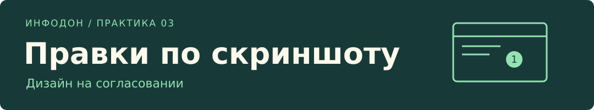

# Правки по скриншоту

Заказчик прислал скриншот главной и написал: «Вот эту кнопку подвиньте». Сделайте инструмент, в котором удобно указать конкретное место, оставить правку и передать результат коллеге.

## Старт без сервера

1. [Сделайте Fork → Create fork](https://github.com/Shugar86/practice-site-feedback/fork). В адресе вашей копии должен появиться **ваш** логин.
2. В своём форке выберите **Code → Open with GitHub Desktop → Clone**. Если используете терминал, скопируйте адрес из **Code → HTTPS** и выполните `git clone АДРЕС_ВАШЕГО_ФОРКА`.
3. В папке на компьютере дважды щёлкните [index.html](index.html). Браузер покажет стартовые материалы. Устанавливать пакеты, получать ключи или поднимать сервер не нужно.
4. Создайте рабочую ветку: **Current Branch → New Branch** или `git switch -c practice` в папке проекта. Можно работать одному или в паре. Стек и устройство экранов выбираете сами.

## Что уже есть

[Учебный скриншот](assets/workshop.png) — вымышленный сайт мастерской, 1120 × 640 px. Можно использовать его на защите. Ваша программа также должна принимать другой локальный PNG или JPEG.

## Что показать на сдаче

1. Загрузите скриншот. Нажмите на кнопку «Смотреть коллекцию», оставьте комментарий; вторую правку привяжите к надписи «Из мастерской». Из списка должно быть понятно, к какой метке относится каждый комментарий.
2. Откройте ту же картинку на ширине 390 px. Обе метки по-прежнему указывают на свои места. Отметьте одну правку выполненной; вторая остаётся открытой.
3. Передайте работу **одним файлом**. Откройте его в чистой копии приложения или в отдельном браузере: видны исходная картинка, обе метки, тексты и статусы. Формат выбирайте сами, например самодостаточный HTML или импортируемый JSON со встроенной картинкой. Отправлять исходный PNG вторым файлом не требуется.

## Как сдать

Обновите инструкцию запуска, закоммитьте работу и отправьте ветку в свой форк (**Publish branch** в GitHub Desktop или `git push -u origin practice`). Пришлите в группу ссылку на ветку или PR и короткую запись экрана либо покажите сценарии по видеосвязи. ИИ использовать можно; объясните своими словами одно своё решение.
